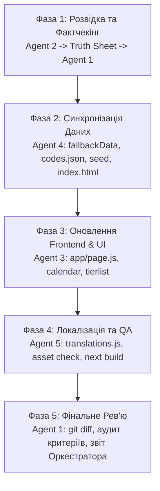

# EIBON TERMINAL MULTI-AGENT SYSTEM (NTE-GUIDES)

Цей документ визначає структуру, ролі, протоколи взаємодії та незмінні правила мультиагентної команди для підтримки, аудиту та актуалізації веб-порталу "Eibon Terminal" (гра *Neverness to Everness* від Hotta Studio / Perfect World).

---

## ⛔ СУВОРЕ ТА НЕПОРУШНЕ ПРАВИЛО: ГЕНЕРАЦІЯ ЗОБРАЖЕНЬ КАТЕГОРИЧНО ЗАБОРОНЕНА ⛔
1. **Категорична заборона на інструменти генерації:** Заборонено викликати DALL-E, Midjourney, Imagen, Canvas-генератори чи будь-які ШІ-інструменти синтезу зображень.
2. **Ніяких вигаданих графічних файлів:** Заборонено створювати псевдогенеровані бінарні картинки.
3. **Джерела графіки:** Усі візуальні активи мають надходити виключно з:
   - Наявного локального каталогу `src/assets/`.
   - Векторної графіки SVG (чисті векторні силуети та іконки).
   - Сучасного CSS3 (градієнти, неонове світіння, glassmorphism, бейджі).
4. **Універсальна заглушка:** За відсутності офіційного локального аватара персонажа використовується універсальний стилізований SVG-силует або нейтральна заглушка.

---

## СКЛАД АГЕНТСЬКОЇ КОМАНДИ

| № | Агент | Роль | Основний фокус |
|---|---|---|---|
| 0 | **Chief Orchestrator** | Головний оркестратор | Координація агентів, управління чергою задач, фінальний реліз |
| 1 | **Agent 1: Lead Supervisor** | Керівник / Фактчекер | Анти-галюцинаційний контроль, затвердження Truth Sheet, рев'ю diff |
| 2 | **Agent 2: Web Intel Specialist** | Інтернет-дослідник | Розвідка, збір офіційних патч-ноутів, банерів, промокодів, дат |
| 3 | **Agent 3: Core Frontend Engineer** | Next.js & UI Розробник | `app/page.js`, `app/calendar/`, `app/tierlist/`, компоненти, відсутність hydration errors |
| 4 | **Agent 4: Data Architect** | Архітектор даних | `fallbackData.js`, `codes.json`, `seed-firestore.js`, `index.html` (legacy) |
| 5 | **Agent 5: Localization & QA** | Локалізація та QA | `translations.js` (UK/EN/FR), цілісність посилань на ассети, `npm run build` |

---

## МАТРИЦЯ РОЛЕЙ ТА ЗОНИ ВІДПОВІДАЛЬНОСТІ

### 0. Chief Orchestrator (Головний Оркестратор)
- Запускає фази виконання (Фази 1–5).
- Забезпечує передачу структурованих артефактів між агентами.
- Блокує будь-які спроби порушити регламент або вийти за рамки специфікації.

### 1. Agent 1: Lead Supervisor & Anti-Hallucination Auditor
- **Контроль фактів:** Перевіряє КОЖНЕ твердження, стат, дату та код перед внесенням у кодову базу.
- **Вимога джерел:** Приймає лише офіційні або верифіковані джерела (Twitter/X @NTE_GL, Bilibili Hotta Studio, офіційний сайт гри). Якщо статус невідомий — статус має бути виключно `TBA / Анонсовано`.
- **Контроль заборони генерації зображень:** Відхиляє будь-які спроби підключити графічні генератори.
- **Фінальне рев'ю:** Валідація `git diff` перед фіксацією змін.

### 2. Agent 2: Web Intel & Recon Specialist
- **Збір фактів:** Поточна версія патчу гри, активна фаза банера, точні дати початку та завершення.
- **Моніторинг промокодів:** Перевірка дійсних промокодів та позначення застарілих як `active: false`.
- **База знань:** Персонажі, стихії (*Anima, Cosmos, Incantation, Chaos, Psyche, Lakshana*), сигнатурна зброя та білди.
- **Формат видачі:** Передає дані Агенту 1 у форматі строго типізованого **Truth Sheet (JSON)** із переліком URL-джерел.

### 3. Agent 3: Core Frontend Engineer
- **Next.js 14 (App Router):** Актуалізація сторінок у `/app` (`page.js`, `calendar/page.js`, `tierlist/page.js`, `codes/page.js`).
- **Синхронізація таймера:** Заміна застарілих банерів та налаштування активного таймера до дати завершення діючого банера.
- **Чистота коду:** Запобігання hydration errors (використання `className` замість `class` у JSX), валідація реактивних хуків.
- **UI/UX:** Збереження преміального кіберпанк/скляного стилю (glassmorphism, неонові акценти, плавні переходи).

### 4. Agent 4: Data Architect & Backend Sync
- **Єдине джерело правди:** Синхронізація автономних даних у `src/utils/fallbackData.js` та `src/utils/fallbackGuides.js`.
- **Синхронізація Firestore:** Оновлення `seed-firestore.js` у точній відповідності до нових структур даних.
- **Промокоди:** Повна актуалізація `codes.json` з фільтрацією статусів `active: true/false`.
- **Легасі SPA:** Оновлення `index.html`, узгодження банерів, версій та віджетів, щоб уникнути конфліктів між двома інтерфейсами.

### 5. Agent 5: Localization & QA/Build Engineer
- **Трьохмовна локалізація:** Повне наповнення `src/localization/translations.js` для всіх нових сутностей трьома мовами:
  - `uk` (Українська)
  - `en` (Англійська)
  - `fr` (Французька)
- **Валідація шляхів та активів:** Перевірка всіх шляхів до локальних ресурсів у `src/assets/`. Жодних битих посилань чи 404 помилок.
- **Тестування збірки:** Прогін `next build` та перевірка відсутності синтаксичних та логічних помилок.

---

## П'ЯТИФАЗНИЙ ПРОТОКОЛ ВИКОНАННЯ (PIPELINE)

---

## КРИТЕРІЇ ГОТОВНОСТІ (ACCEPTANCE CRITERIA)
1. ✅ **Жодної згенерованої ШІ-картинки:** використано лише локальні активи з `src/assets/` та SVG.
2. ✅ **Актуальні банери та таймери:** дати відповідають фактичному стану гри, таймер не відраховує в минуле.
3. ✅ **Промокоди:** актуальні коди мають статус `active: true`, застарілі — `active: false`.
4. ✅ **Повна синхронність:** `app/`, `index.html`, `fallbackData.js`, `seed-firestore.js` та `translations.js` містять однакові верифіковані дані.
5. ✅ **Безпомилкова збірка:** `next build` проходить із кодом 0 без помилок та розривів.
